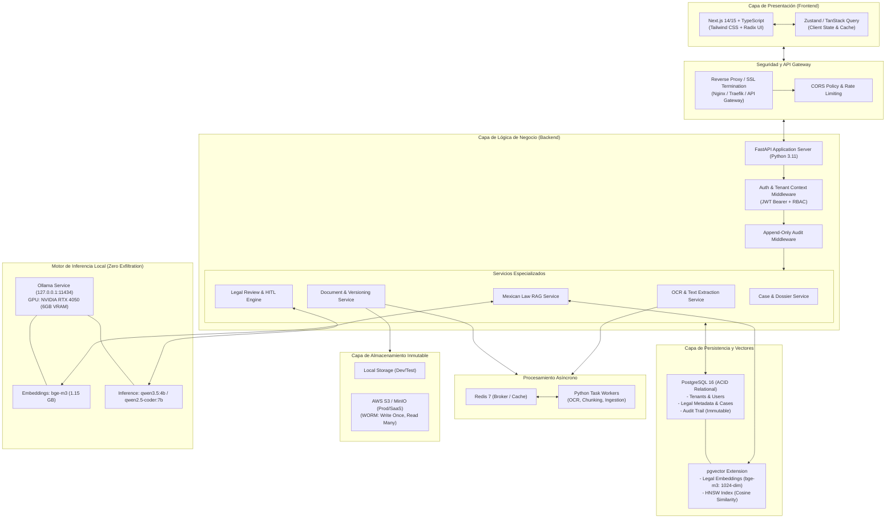
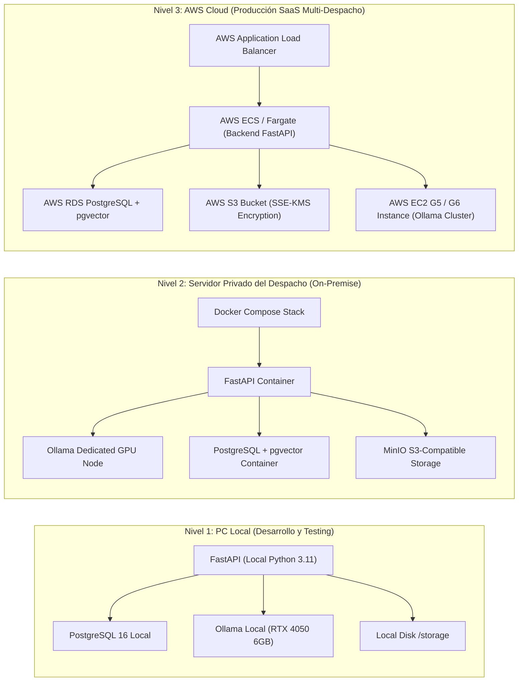
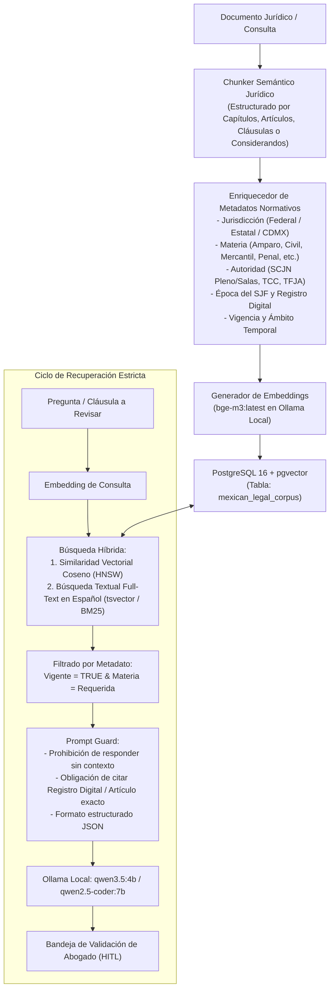
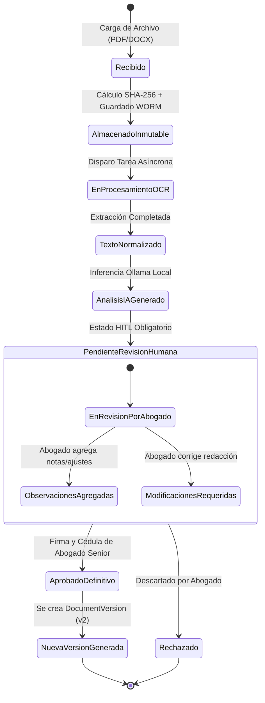

# Arquitectura Técnica del Sistema LegalAI México

## 1. Visión General del Sistema

**LegalAI México** es una plataforma empresarial multi-inquilino (*multi-tenant*) de inteligencia artificial diseñada para la revisión, análisis, extracción y gestión integral de documentos jurídicos en la República Mexicana.

El sistema está concebido bajo el principio rector de **Human-in-the-Loop (HITL)**: *la inteligencia artificial actúa como asistente de copiloto jurídico de alta precisión; ninguna conclusión, recomendación, extracción o cambio documental surte efecto definitivo sin la aprobación explícita y trazable de un abogado facultado*.

---

## 2. Diagnóstico del Entorno de Ejecución Local

Con base en la inspección directa del host realizada por el equipo de ingeniería:

| Recurso | Especificación Detectada | Directriz Arquitectónica |
| :--- | :--- | :--- |
| **Sistema Operativo** | Windows 11 Pro (Build 10.0.26300) | Compatible con desarrollo local nativo y Docker Desktop. |
| **CPU** | AMD Ryzen 5 7535HS (6 núcleos, 12 hilos, 3.3–4.55 GHz) | Capacidad suficiente para pipelines de OCR, hashing SHA-256 concurrente y servidor web. |
| **Memoria RAM** | 16 GB DDR5 (Visible: 15.2 GB, Libre: ~4.3 GB) | Límite estricto: no se deben ejecutar modelos LLM en CPU que excedan 8 GB de RAM. |
| **GPU Dedicada** | NVIDIA GeForce RTX 4050 Laptop GPU (6 GB GDDR6, CUDA 12.7) | **Acelerador de IA primario**: Offload completo de modelos LLM ≤ 4B–7B y embeddings `bge-m3`. |
| **Almacenamiento** | Disco C (SSD NVMe): 622.6 GB libres de 952.8 GB | Almacenamiento local seguro para desarrollo y staging documental. |
| **Python** | Python 3.11.15 (`C:\Users\Asus\.local\bin\python3.11.exe`) | Versión estándar corporativa para backend FastAPI, PyTorch, SQLAlchemy y pgvector. |
| **Node.js / npm** | Node v22.23.1 / npm 10.9.8 | Runtime para frontend Next.js 14/15 con TypeScript. |
| **Ollama** | Ollama v0.40.16 en `127.0.0.1:11434` | Inferencia estrictamente en localhost. No expuesto a internet. Modelos verificados: `bge-m3` (embeddings), `qwen3.5:4b`, `qwen2.5-coder:7b`, `hermes3:8b`. |
| **PostgreSQL** | PostgreSQL 16 local (`localhost:5432`) | Servicio activo para persistencia relacional transaccional. |
| **Docker** | Docker CLI 29.6.1 (Demonio actualmente inactivo) | El sistema soportará ejecución local desacoplada y modo contenerizado completo. |

---

## 3. Diagrama de Arquitectura Global



---

## 4. Estrategia de Aislamiento Multi-Tenant (Despachos Jurídicos)

El bufete de abogados inicial y los futuros clientes de la versión SaaS operan bajo un esquema de **Aislamiento Lógico Estricto con Particionamiento Tenant-Aware**:

1. **Identificador Canónico (`tenant_id`):**
   * Cada registro en las tablas operativas (`cases`, `documents`, `document_versions`, `ai_analyses`, `legal_validations`, `audit_logs`) contiene una clave foránea obligatoria `tenant_id` con índice B-Tree.
2. **Middleware de Inyección de Contexto:**
   * En FastAPI, cada solicitud entrante es interceptada por el `TenantContextMiddleware`.
   * El `tenant_id` se extrae de los claims verificados del token JWT firmado criptográficamente (HMAC-SHA256 con clave secreta rotativa o asimétrica RS256).
   * Se almacena en una variable de contexto asíncrona (`contextvars.ContextVar`), asegurando que ninguna función de base de datos pueda consultar datos sin filtrar implícita o explícitamente por el `tenant_id` activo.
3. **Seguridad a Nivel de Fila (PostgreSQL Row-Level Security - RLS):**
   * Se habilitará RLS en PostgreSQL:
     ```sql
     ALTER TABLE documents ENABLE ROW LEVEL SECURITY;
     CREATE POLICY tenant_isolation_policy ON documents
     USING (tenant_id = current_setting('app.current_tenant_id')::uuid);
     ```
4. **Aislamiento en Almacenamiento de Archivos:**
   * La estructura de almacenamiento de objetos separa estrictamente las rutas:
     `storage://tenants/{tenant_id}/cases/{case_id}/documents/{document_id}/{sha256_hash}.pdf`
   * Los enlaces de descarga son URLs prefirmadas temporales con expiración máxima de 15 minutos, accesibles únicamente tras validación de sesión y permisos.

---

## 5. Estrategia de Comunicación: PC Local, Servidor Privado y AWS

La arquitectura está concebida bajo un modelo **Híbrido de 3 Niveles** (*Three-Tier Hybrid Deployment*) para permitir el ciclo completo desde desarrollo local hasta despliegue corporativo en servidor privado on-premise o nube AWS:



### Protocolo de Interconexión y Gobernanza:
* **Entorno 1 (PC Local):** Funciona 100% desconectado de internet o de servidores externos para garantizar cero filtraciones durante el desarrollo.
* **Entorno 2 (Servidor Privado / On-Premise):** Ideal para despachos con políticas estrictas de secreto profesional (Art. 16 Constitucional, Secreto Profesional del Abogado y Ley Federal de Protección de Datos Personales en Posesión de Particulares - LFPDPPP). Todo el ciclo de vida documental y la inferencia de IA residen dentro de la red local del despacho (LAN/VLAN).
* **Entorno 3 (Nube AWS Multi-Despacho):**
  * Comunicación cifrada en tránsito obligatoria (TLS 1.3).
  * Reposo: Cifrado con AWS KMS con llaves independientes por despacho (*Bring Your Own Key - BYOK*).
  * Inferencia de IA: Instancias EC2 dedicadas con GPU (G5 con NVIDIA A10G) en subredes privadas sin IP pública ni acceso directo a internet, comunicadas exclusivamente mediante VPC Peering / PrivateLink con el backend FastAPI.

---

## 6. Arquitectura RAG Especializada en Jurisdicción Mexicana

Para cumplir con la directriz de **no inventar leyes, jurisprudencias ni citas**, el motor RAG estructura la información bajo los cánones del sistema jurídico mexicano:



---

## 7. Principio de Inmutabilidad Documental y Human-in-the-Loop (HITL)



### Reglas Criptográficas y de Auditoría:
1. El archivo binario original se almacena bajo su hash `SHA-256`. Su registro en base de datos es inmutable (`is_original = true`, `is_locked = true`).
2. Cualquier sugerencia de cambio generada por la IA se guarda en la tabla `ai_suggestions` con un campo diff (formato JSON RFC 6902 / diff visual unificado).
3. La tabla `legal_validations` registra:
   * `validator_user_id`: ID del abogado.
   * `professional_license`: Cédula profesional del abogado.
   * `validation_status`: `APPROVED_AS_IS`, `APPROVED_WITH_MODIFICATIONS`, `REJECTED`.
   * `timestamp`: Fecha y hora UTC con zona horaria de México (America/Mexico_City).
   * `audit_hash`: Firma criptográfica del dictamen.
