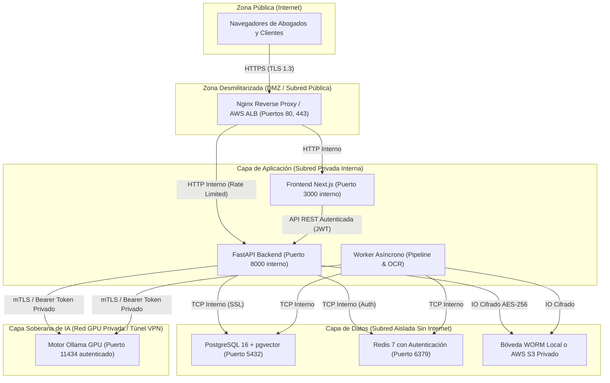

# Arquitectura de Redes y Seguridad Perimetral
## LegalAI México • Plataforma Jurídica Empresarial

Este documento describe la topología de red, segmentación de subredes, políticas de cortafuegos (Firewalls / Security Groups), flujos de comunicación autenticada y mecanismos de aislamiento implementados para proteger el secreto profesional y la soberanía de los datos jurídicos.

---

## 1. Diagrama de Segmentación de Redes (Zero Trust)

---

## 2. Matriz de Puertos y Control de Accesos

| Servicio | Puerto Interno | Puerto Expuesto al Exterior | Protocolo | Restricción de Origen |
| :--- | :--- | :--- | :--- | :--- |
| **Nginx / ALB** | 80, 443 | 80, 443 | HTTP / HTTPS (TLS 1.3) | Público (`0.0.0.0/0`) con redirección forzosa a HTTPS. |
| **Frontend Next.js** | 3000 | **Ninguno** | HTTP | Únicamente accesible desde Nginx / ALB. |
| **Backend FastAPI** | 8000 | **Ninguno** | HTTP | Únicamente accesible desde Nginx / ALB y Frontend. |
| **PostgreSQL 16** | 5432 | **Ninguno** (Bloqueado) | PostgreSQL Wire Protocol | Únicamente accesible desde `backend`, `worker` y `db_backup`. |
| **Redis 7** | 6379 | **Ninguno** (Bloqueado) | RESP con contraseña | Únicamente accesible desde `backend` y `worker`. |
| **Ollama Local GPU** | 11434 | **Ninguno** (Estrictamente Bloqueado) | HTTP / mTLS | Únicamente accesible desde `backend` y `worker` vía red privada o localhost. |

---

## 3. Política de Comunicación Segura con Ollama (Data Egress Boundary)

Para cumplir con la prohibición deontológica de compartir información de clientes con nubes públicas de IA, el sistema implementa un candado criptográfico y de red en tres capas:

1. **Aislamiento a Nivel de Enlace:**
   - La instancia de Ollama se enlaza estrictamente a `127.0.0.1:11434` o a la red privada `ai_private_net`.
   - Queda terminantemente prohibido mapear el puerto `11434` hacia `0.0.0.0` en la interfaz pública del host.

2. **Autenticación Mutua y Tokens en Servidor Privado:**
   - En despliegues donde el cómputo GPU reside en un nodo dedicado de la red local, el tráfico entre FastAPI y Ollama transita a través de un proxy inverso con autenticación por **Bearer Token** (`OLLAMA_API_KEY`) y cifrado TLS 1.3.

3. **Guardián de Exfiltración (`Zero-Cloud-Egress Guard`):**
   - El cliente [`OllamaClient`](file:///C:/Users/Asus/proyecto%20legal%20agy/backend/app/services/ai/ollama_client.py) valida programáticamente en tiempo de ejecución que el host de destino no resuelva a direcciones IP públicas ni pertenezca a dominios comerciales de IA (*OpenAI, Anthropic, AWS Bedrock, Google Cloud, Groq*).
   - Cualquier intento de configurar una URL pública generará una excepción bloqueante `ForbiddenException (HTTP 403)`.

---

## 4. Configuración de Grupos de Seguridad en AWS (Security Groups)

En caso de optar por la modalidad híbrida en AWS, los grupos de seguridad deben apegarse a la siguiente matriz de reglas:

### SG-ALB (Balanceador de Carga Público)
- **Inbound:**
  - `TCP 80` desde `0.0.0.0/0` (Redirección a HTTPS).
  - `TCP 443` desde `0.0.0.0/0` (Tráfico HTTPS cifrado).
- **Outbound:**
  - `TCP 8000` y `TCP 3000` hacia `SG-ECS-Tasks`.

### SG-ECS-Tasks (Capa de Contenedores de Aplicación)
- **Inbound:**
  - `TCP 3000` desde `SG-ALB`.
  - `TCP 8000` desde `SG-ALB`.
- **Outbound:**
  - `TCP 5432` hacia `SG-RDS`.
  - `TCP 6379` hacia `SG-ElastiCache`.
  - `TCP 443` hacia VPC Endpoints (S3, KMS, CloudWatch).
  - `TCP 11434` hacia la subred del túnel VPN on-premises.

### SG-RDS (Base de Datos Aislada)
- **Inbound:**
  - `TCP 5432` únicamente desde `SG-ECS-Tasks`.
- **Outbound:**
  - Denegado totalmente (`Deny All`).

### SG-ElastiCache (Caché & Cola)
- **Inbound:**
  - `TCP 6379` únicamente desde `SG-ECS-Tasks`.
- **Outbound:**
  - Denegado totalmente (`Deny All`).

---

## 5. Inspección y Detección de Anomalías

- **Logs de Flujo de Red (VPC Flow Logs):** Todos los paquetes entrantes y salientes son registrados para auditar cualquier intento de conexión a puertos no autorizados.
- **WAF (Web Application Firewall):** Inspección de encabezados HTTP, mitigación de ataques DDoS y bloqueo de inyecciones SQL / XSS antes de alcanzar los contenedores.
